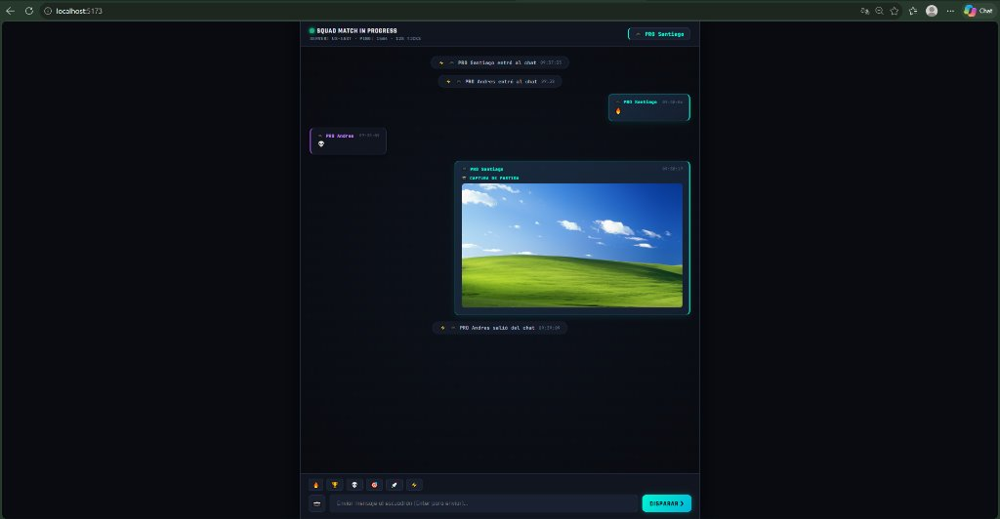

# Chat en Vivo - Cliente Frontend (chat-client)
> **DOSW 1 - Semana 15 - WebSockets, STOMP y Tematica Personalizada**  
> **Estudiante:** Santiago Andres Garcia Almario  
> **Repositorio Backend:** [chat-server](https://github.com/SantiagoAndresGarciaAlmario01/chat-server)

---

## 1. Descripcion del Proyecto

chat-client es la interfaz web interactiva para la aplicacion de chat en vivo con tematica Lobby Gamer / Cyberpunk Squad Comms (NEXUS COMMS). Desarrollado con React 19, Vite y la libreria `@stomp/stompjs`, proporciona una experiencia fluida, reactiva y de ultra-baja latencia para la comunicacion tactica entre jugadores.

---

## 2. Tematica Visual: Lobby Gamer (NEXUS COMMS) (Paso 8)

El cliente fue transformado bajo una estetica inmersiva de sala de espera gamer:
* **Paleta de Colores:** Fondo oscuro profundo (Deep Void `#090b10` y Cyber Slate `#11151f`), bordes estructurados y contrastes fluorescentes en Neon Cian (`#00f5d4`), Purpura Tactico (`#9d4edd`) y Verde Estado (`#10b981`).
* **Tipografias:** `Rajdhani` (estetica moderna y deportiva para titulos y controles) y `JetBrains Mono` (para estadisticas, terminales y marcas temporales).
* **Pantalla de Ingreso Tactica:**
  * Selector interactivo de rangos competitivos: PRO, MASTER, DIAMOND, RADIANT.
  * Campo de GamerTag / Apodo con validacion.
  * Boton con efecto de elevacion y resplandor neon: CONECTAR AL LOBBY.
* **Cabecera de Partida en Vivo:**
  * Indicador pulsante en verde: SQUAD MATCH IN PROGRESS.
  * Metricas de red: SERVER: US-EAST - PING: 15ms - 128 TICKS.
* **Diseno de Burbujas de Chat:**
  * **Mensajes Propios (`.mio`):** Alineados a la derecha con degradado cian-marino y borde resplandeciente.
  * **Mensajes de Escuadron (`.otro`):** Alineados a la izquierda en tarjeta oscura con acento purpura y apodo resaltado.
  * **Alertas del Sistema (`.mensaje-sistema`):** Banners redondeados estilo terminal con identificador de sistema para eventos de conexion y abandono de sala.

---

## 3. Funcionalidades Extra Implementadas (Paso 9)

1. **Compartir Capturas de Partida / Imagenes:**
   * Boton tactico de camara integrado en la barra de control.
   * Permite seleccionar cualquier imagen desde el dispositivo local.
   * La imagen se transfiere mediante HTTP multipart/form-data al endpoint `/api/archivos` del backend y se emite la URL via WebSocket a la sala `/topic/sala`.
   * En el chat se renderiza con marco estilizado, etiqueta de captura de partida y soporte para apertura en tamano completo.
2. **Indicador de "Esta escribiendo..." en tiempo real:**
   * Publica en `/app/chat.escribiendo` cuando el jugador interactua con el teclado.
   * Se suscribe a `/topic/escribiendo` y muestra un pulso animado con el mensaje indicando que el jugador esta tecleando en el canal, con apagado automatico tras 1.8 segundos de inactividad.
3. **Reacciones Rapidas de Escuadron:**
   * Barra de acceso directo para enviar reacciones tacticas con un solo clic.

---

## 4. Destinos STOMP Utilizados

El cliente se conecta al endpoint de Handshake `ws://localhost:8080/ws` y gestiona las siguientes rutas STOMP:

### Publicaciones (Hacia el Servidor /app/...):
* `/app/chat.unirse`: Notifica la conexion del jugador `{ tipo: "UNION", autor: "[RANGO] [Tag]" }`.
* `/app/chat.enviar`: Transmite mensajes `{ tipo, autor, contenido }`.
* `/app/chat.escribiendo`: Informa el evento de tipeo en vivo.

### Suscripciones (Desde el Broker /topic/...):
* `/topic/sala`: Escucha todos los mensajes entrantes de los participantes y avisos del sistema.
* `/topic/escribiendo`: Escucha que jugador esta escribiendo en el momento.

---

## 5. Instrucciones de Ejecucion en Local

### Prerrequisitos:
* Node.js 20+ instalado.
* El servidor [chat-server](https://github.com/SantiagoAndresGarciaAlmario01/chat-server) debe estar ejecutandose en http://localhost:8080.

### Pasos:

1. **Clonar el repositorio:**
   ```bash
   git clone https://github.com/SantiagoAndresGarciaAlmario01/chat-client.git
   cd chat-client
   ```

2. **Instalar dependencias:**
   ```bash
   npm install
   ```

3. **Iniciar en modo desarrollo:**
   ```bash
   npm run dev
   ```

4. **Abrir en el navegador:**
   * Abre http://localhost:5173 en 2 o mas pestanas para simular multiples jugadores en el lobby.

---

## 6. Galeria de Evidencias

### A. Pantalla de Login Gamer (Seleccion de Rango y GamerTag)


### B. Chat en Vivo e Intercambio de Capturas (Perspectiva de Santiago)


### C. Chat en Vivo Sincronizado en Tiempo Real (Perspectiva de Andres)


### D. Deteccion Automatica de Salida de Jugadores


### E. Tablero de Observabilidad en Grafana


### F. Correlacion de Logs en Loki por traceId


---

## 7. Preguntas de Reflexion Tecnica

### 1. Por que un chat con HTTP normal tendria que estar preguntandole al servidor cada segundo, y que cambia con WebSocket?
Bajo el modelo HTTP tradicional, el cliente es siempre el iniciador. Para que una pestana se entere de un nuevo mensaje, tendria que hacer peticiones recurrentes (polling) continuas. Esto satura el servidor con peticiones innecesarias en momentos de silencio, consume ancho de banda con cabeceras duplicadas y anade un retraso minimo correspondiente al intervalo de sondeo.  
Con WebSocket, una vez establecido el canal mediante el Handshake (101 Switching Protocols), la conexion TCP queda permanentemente abierta de forma bidireccional (full-duplex). Cuando alguien publica un mensaje, el servidor lo empuja inmediatamente al socket del cliente sin ninguna demora ni necesidad de sondeo previo.

### 2. Por que las imagenes y los audios se suben por HTTP y no viajan dentro del WebSocket?
El protocolo STOMP sobre WebSocket esta optimizado para tramas pequenas de texto y metadatos de senalizacion de alta velocidad. Empaquetar imagenes de varios megabytes por WebSocket congestionaria la cola de mensajes del broker, consumiria excesiva memoria del hilo de procesamiento y bloquearia temporalmente la entrega de los mensajes de texto de los demas usuarios. Al usar HTTP POST `/api/archivos`, el servidor procesa el archivo de forma asincrona mediante streaming multipart, lo almacena en disco y solo devuelve una URL corta que viaja instantaneamente por el WebSocket.

### 3. Si el servidor se reinicia, que pasa con los usuarios conectados y que hace reconnectDelay?
Al caer el servidor, los sockets TCP de todos los clientes se cierran. Sin una logica de reconexion, la aplicacion quedaria desconectada permanentemente hasta que el usuario recargue manualmente la pestana. La configuracion `reconnectDelay: 3000` de `@stomp/stompjs` activa un reintento automatico programado cada 3 segundos en segundo plano. Cuando el backend vuelve a estar activo, el cliente se reconecta y se re-suscribe a `/topic/sala` sin intervencion del usuario.

### 4. Que metrica te avisaria primero de que el chat esta fallando, y que alerta pondrias sobre ella?
La metrica mas elocuente es la combinacion de la tasa de peticiones con error `http_server_requests_seconds_count{status=~"5.."}` y una disminucion abrupta en el Gauge `chat_usuarios_conectados`. Si la derivada de usuarios conectados cae bruscamente o la tasa de errores HTTP/WS supera el 5%, una alerta configurada en Grafana/Prometheus emitira una notificacion de anomalia critica.

### 5. En Style Radar, que servicio se beneficiaria de WebSockets y que tablero le armarias a cada microservicio?
* **Microservicio Beneficiado:** El microservicio de Radar de Tendencias y Ofertas Relampago: permitiria que cuando una prenda entre en rebaja o se agote su stock, todos los usuarios que la tienen en pantalla vean la actualizacion inmediata sin necesidad de refrescar la pagina.
* **Tableros Recomendados:**
  * **Servicio de Productos/Tendencias:** Graficas de visualizaciones por minuto, latencia de base de datos y memoria de la JVM.
  * **Servicio de Pagos:** Tablero de transacciones exitosas vs rechazadas, latencia de la pasarela y mapa de trazas distribuidas con Zipkin para monitorear el flujo completo de pago.

---

## Autores y Entrega
* **Estudiante:** Santiago Andres Garcia Almario
* **Materia:** DOSW 1 - Semana 15
* **Entrega:** Repositorio publico de GitHub vinculado con Microsoft Teams.
