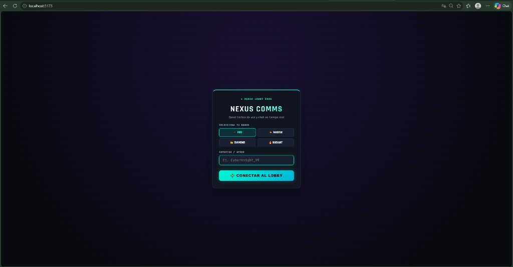
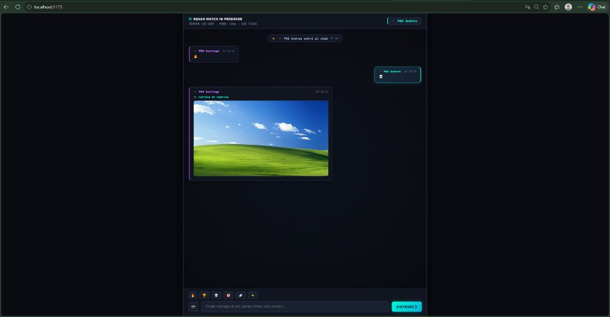
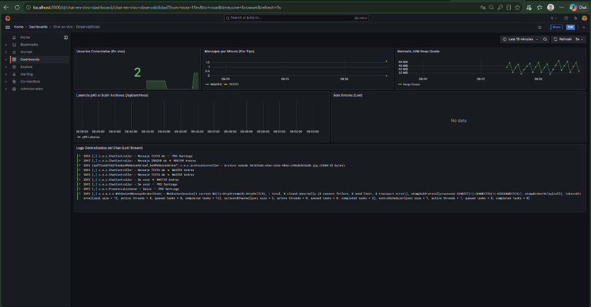
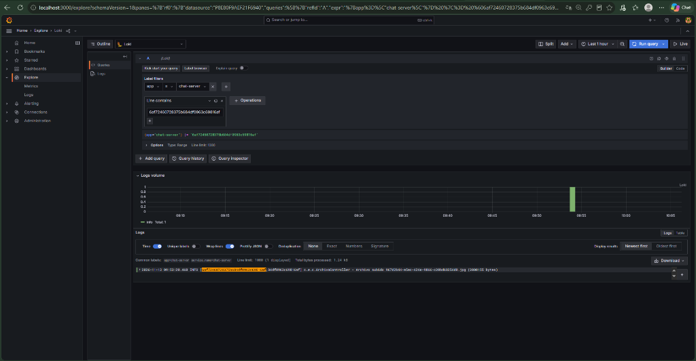

# 🎮 Chat en Vivo · Cliente Frontend (`chat-client`)
> **DOSW 1 · Semana 15 · WebSockets, STOMP y Temática Personalizada**  
> **Estudiante:** Santiago Andrés García Almario  
> **Repositorio Backend:** [chat-server](https://github.com/SantiagoAndresGarciaAlmario01/chat-server)

---

## 📌 1. Descripción del Proyecto

`chat-client` es la interfaz web interactiva para la aplicación de chat en vivo con temática **Lobby Gamer / Cyberpunk Squad Comms (NEXUS COMMS)**. Desarrollado con **React 19**, **Vite** y la librería **`@stomp/stompjs`**, proporciona una experiencia fluida, reactiva y de ultra-baja latencia para la comunicación táctica entre jugadores.

---

## 🎨 2. Temática Visual: "Lobby Gamer (NEXUS COMMS)" (Paso 8)

El cliente fue transformado desde cero bajo una estética inmersiva de sala de espera gamer (estilo Discord / Cyberpunk / Twitch):
* **Paleta de Colores:** Fondo oscuro profundo (*Deep Void* `#090b10` y *Cyber Slate* `#11151f`), bordes estructurados y contrastes fluorescentes en **Neón Cian** (`#00f5d4`), **Púrpura Táctico** (`#9d4edd`) y **Verde Estado** (`#10b981`).
* **Tipografías:** `Rajdhani` (estética moderna y deportiva para títulos y controles) y `JetBrains Mono` (para estadísticas, terminales y marcas temporales).
* **Pantalla de Ingreso Táctica:**
  * Selector interactivo de rangos competitivos: `🎮 PRO`, `⚡ MASTER`, `👑 DIAMOND`, `🔥 RADIANT`.
  * Campo de *GamerTag* / Apodo con validación.
  * Botón con efecto de elevación y resplandor neón: `⚡ CONECTAR AL LOBBY`.
* **Cabecera de Partida en Vivo:**
  * Indicador pulsante en verde: `SQUAD MATCH IN PROGRESS`.
  * Métricas simuladas de red: `SERVER: US-EAST · PING: 15ms · 128 TICKS`.
* **Diseño de Burbujas de Chat:**
  * **Mensajes Propios (`.mio`):** Alineados a la derecha con degradado cian-marino y borde resplandeciente.
  * **Mensajes de Escuadrón (`.otro`):** Alineados a la izquierda en tarjeta oscura con acento púrpura y apodo resaltado.
  * **Alertas del Sistema (`.mensaje-sistema`):** Banners redondeados estilo terminal con icono `⚡` para eventos de conexión y abandono de sala.

---

## ⚡ 3. Funcionalidades Extra Implementadas (Paso 9)

1. 📸 **Compartir Capturas de Partida / Imágenes:**
   * Botón táctico de cámara (`📷`) integrado en la barra de control.
   * Permite seleccionar cualquier imagen desde el dispositivo local.
   * La imagen se transfiere mediante HTTP `multipart/form-data` al endpoint `/api/archivos` del backend y se emite la URL vía WebSocket a la sala `/topic/sala`.
   * En el chat se renderiza con marco estilizado, etiqueta `📸 CAPTURA DE PARTIDA` y soporte para apertura en tamaño completo.
2. ✍️ **Indicador de "Está escribiendo..." en tiempo real:**
   * Publica en `/app/chat.escribiendo` cuando el jugador interactúa con el teclado.
   * Se suscribe a `/topic/escribiendo` y muestra un pulso animado con el mensaje: `🎮 [Jugador] está tecleando en el canal...` con apagado automático tras 1.8 segundos de inactividad.
3. 🔥 **Reacciones Rápidas de Escuadrón:**
   * Barra de acceso directo para enviar reacciones tácticas con un solo clic: 🔥, 🏆, 💀, 🎯, 🚀, ⚡.

---

## 📡 4. Destinos STOMP Utilizados

El cliente se conecta al endpoint de Handshake `ws://localhost:8080/ws` y gestiona las siguientes rutas STOMP:

### Publicaciones (Hacia el Servidor `/app/...`):
* `/app/chat.unirse`: Notifica la conexión del jugador `{ tipo: "UNION", autor: "[RANGO] [Tag]" }`.
* `/app/chat.enviar`: Transmite mensajes `{ tipo, autor, contenido }`.
* `/app/chat.escribiendo`: Informa el evento de tipeo en vivo.

### Suscripciones (Desde el Broker `/topic/...`):
* `/topic/sala`: Escucha todos los mensajes entrantes de los participantes y avisos del sistema.
* `/topic/escribiendo`: Escucha qué jugador está escribiendo en el momento.

---

## 🚀 5. Instrucciones de Ejecución en Local

### Prerrequisitos:
* **Node.js 20+** instalado.
* El servidor [`chat-server`](https://github.com/SantiagoAndresGarciaAlmario01/chat-server) debe estar ejecutándose en `http://localhost:8080`.

### Pasos:

1. **Clonar el repositorio:**
   ```bash
   git clone https://github.com/SantiagoAndresGarciaAlmario01/chat-client.git
   cd chat-client
   ```

2. **Instalar dependencias:**
   ```bash
   npm install
   ```

3. **Iniciar en modo desarrollo:**
   ```bash
   npm run dev
   ```

4. **Abrir en el navegador:**
   * Abre `http://localhost:5173` en 2 o más pestañas para simular múltiples jugadores en el lobby.

---

## 📸 6. Galería de Evidencias

### A. Pantalla de Login Gamer (Selección de Rango y GamerTag)


### B. Chat en Vivo e Intercambio de Capturas (Perspectiva de Santiago)


### C. Chat en Vivo Sincronizado en Tiempo Real (Perspectiva de Andrés)


### D. Detección Automática de Salida de Jugadores


### E. Tablero de Observabilidad en Grafana


### F. Correlación de Logs en Loki por traceId


---

## 💡 7. Preguntas de Reflexión Técnica

### 1. ¿Por qué un chat con HTTP normal tendría que estar preguntándole al servidor cada segundo, y qué cambia con WebSocket?
Bajo el modelo HTTP tradicional, el cliente es siempre el iniciador. Para que una pestaña se entere de un nuevo mensaje, tendría que hacer peticiones recurrentes (*polling*) continuas. Esto satura el servidor con peticiones innecesarias en momentos de silencio, consume ancho de banda con cabeceras duplicadas y añade un retraso mínimo correspondiente al intervalo de sondeo.  
Con **WebSocket**, una vez establecido el canal mediante el Handshake (101 Switching Protocols), la conexión TCP queda permanentemente abierta de forma bidireccional (*full-duplex*). Cuando alguien publica un mensaje, el servidor lo empuja inmediatamente al socket del cliente sin ninguna demora ni necesidad de sondeo previo.

### 2. ¿Por qué las imágenes y los audios se suben por HTTP y no viajan dentro del WebSocket?
El protocolo STOMP sobre WebSocket está optimizado para tramas pequeñas de texto y metadatos de señalización de alta velocidad. Empaquetar imágenes de varios megabytes por WebSocket congestionaría la cola de mensajes del broker, consumiría excesiva memoria del hilo de procesamiento y bloquearía temporalmente la entrega de los mensajes de texto de los demás usuarios. Al usar HTTP `POST /api/archivos`, el servidor procesa el archivo de forma asíncrona mediante streaming multipart, lo almacena en disco y solo devuelve una URL corta que viaja instantáneamente por el WebSocket.

### 3. Si el servidor se reinicia, ¿qué pasa con los usuarios conectados y qué hace `reconnectDelay`?
Al caer el servidor, los sockets TCP de todos los clientes se cierran. Sin una lógica de reconexión, la aplicación quedaría desconectada permanentemente hasta que el usuario recargue manualmente la pestaña. La configuración `reconnectDelay: 3000` de `@stomp/stompjs` activa un reintento automático programado cada 3 segundos en segundo plano. Cuando el backend vuelve a estar activo, el cliente se reconecta y se re-suscribe a `/topic/sala` sin intervención del usuario.

### 4. ¿Qué métrica te avisaría primero de que el chat está fallando, y qué alerta pondrías sobre ella?
La métrica más elocuente es la combinación de la tasa de peticiones con error `http_server_requests_seconds_count{status=~"5.."}` y una disminución abrupta en el Gauge `chat_usuarios_conectados`. Si la derivada de usuarios conectados cae bruscamente o la tasa de errores HTTP/WS supera el 5%, una alerta configurada en Grafana/Prometheus emitirá una notificación de anomalía crítica.

### 5. En Style Radar, ¿qué servicio se beneficiaría de WebSockets y qué tablero le armarías a cada microservicio?
* **Microservicio Beneficiado:** El microservicio de **Radar de Tendencias y Ofertas Relámpago**: permitiría que cuando una prenda entre en rebaja o se agote su stock, todos los usuarios que la tienen en pantalla vean la actualización inmediata sin necesidad de refrescar la página.
* **Tableros Recomendados:**
  * **Servicio de Productos/Tendencias:** Gráficas de visualizaciones por minuto, latencia de base de datos y memoria de la JVM.
  * **Servicio de Pagos:** Tablero de transacciones exitosas vs rechazadas, latencia de la pasarela y mapa de trazas distribuidas con Zipkin para monitorear el flujo completo de pago.

---

## 👥 Autores y Entrega
* **Estudiante:** Santiago Andrés García Almario
* **Materia:** DOSW 1 · Semana 15
* **Entrega:** Repositorio público de GitHub vinculado con Microsoft Teams.
